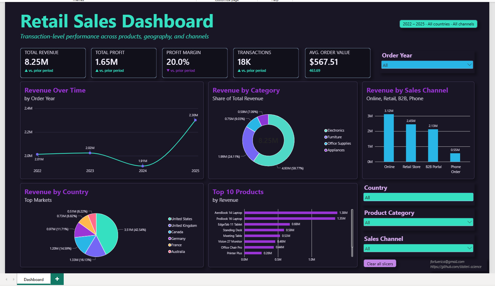

# Retail Sales Analysis Dashboard

An end-to-end retail analytics project analyzing synthetic sales data from 2022 to 2025 using SQL and Power BI. This project explores revenue trends, profitability, product performance, sales channels, and geographic markets through data cleaning, KPI development, and interactive visualization.



## Research Questions

- How did revenue change from 2022 to 2025?
- Which product categories contribute the most to revenue?
- Which sales channels generate the highest revenue?
- Which countries represent the largest markets?
- Which products generate the most revenue?
- What business opportunities can be identified from the observed sales patterns?

## At a Glance

| **Project Detail** | **Description** |
|---|---|
| **Project Type** | Retail Sales Analytics |
| **Period** | 2022–2025 |
| **Dataset** | Synthetic retail transaction data |
| **Tools** | SQL, Microsoft Power BI, DAX, GitHub |
| **Data Preparation** | SQL-based data cleaning and validation |
| **Visualization** | Interactive Power BI dashboard |
| **Main Outcome** | Consolidated analysis of retail sales performance |

## Key Performance Indicators

| **Metric** | **Result** |
|---|---:|
| **Total Revenue** | 8.25M |
| **Total Profit** | 1.65M |
| **Profit Margin** | 20.0% |
| **Transactions** | 18,000 |
| **Average Order Value** | 567.51 |

## Key Findings

### 1. Revenue Trends

| **Year** | **Revenue** |
|---|---:|
| 2022 | 2.01M |
| 2023 | 2.02M |
| 2024 | 1.91M |
| 2025 | 2.30M |

- Revenue remained relatively stable between 2022 and 2023.
- Revenue declined in 2024 before increasing in 2025.
- Revenue in 2025 was approximately 20% higher than in 2024.

### 2. Revenue by Product Category

| **Category** | **Revenue** | **Revenue Share** |
|---|---:|---:|
| Electronics | 4.93M | 59.77% |
| Furniture | 1.99M | 24.11% |
| Office Supplies | 0.75M | 9.03% |
| Appliances | 0.59M | 7.09% |

- Electronics was the largest revenue contributor, accounting for approximately 59.77% of total revenue.
- Furniture ranked second at 24.11%.
- Electronics and Furniture together contributed approximately 83.88% of total revenue.

### 3. Revenue by Sales Channel

| **Sales Channel** | **Revenue** |
|---|---:|
| Online | 3.12M |
| Retail Store | 2.45M |
| B2B Portal | 2.13M |
| Phone Order | 0.55M |

- Online was the highest-revenue sales channel.
- Retail Store and B2B Portal were the next-largest contributors.
- Phone Order generated the lowest revenue among the displayed channels.

### 4. Revenue by Country

| **Country** | **Revenue** | **Revenue Share** |
|---|---:|---:|
| United States | 3.51M | 42.54% |
| United Kingdom | 1.33M | 16.13% |
| Canada | 1.20M | 14.59% |
| Germany | 0.97M | 11.71% |
| France | 0.73M | 8.82% |
| Australia | 0.51M | 6.22% |

- The United States was the largest revenue-generating market, contributing approximately 42.54% of total revenue.
- The United Kingdom and Canada were the next-largest markets among the countries displayed.
- The results highlight the importance of comparing geographic contributions when evaluating sales performance.

### 5. Top Products by Revenue

| **Product** | **Revenue** |
|---|---:|
| AeroBook 14 Laptop | 1.38M |
| ProBook 16 Laptop | 1.35M |
| EdgeTab 11 Tablet | 0.68M |
| Standing Desk | 0.59M |
| Meeting Table | 0.53M |
| Vision 27 Monitor | 0.46M |
| Office Chair Pro | 0.44M |

- AeroBook 14 Laptop and ProBook 16 Laptop were the top two revenue-generating products in the dashboard.
- Product-level rankings provide additional detail beyond category-level performance.

## Methodology

### 1. Data Understanding

The project uses synthetic retail transaction data covering 2022–2025. The data provides the basis for examining sales amounts, profit, product categories, countries, and sales channels.

### 2. Data Cleaning Using SQL

SQL was used as part of the data preparation workflow to prepare the dataset for analysis.

Relevant data quality checks include:

- Reviewing missing or invalid values.
- Checking for duplicate records where appropriate.
- Reviewing data types and field formatting.
- Validating numerical and categorical fields.
- Preparing consistent fields for reporting.

*The specific cleaning operations should be documented according to the SQL scripts implemented in the project.*

### 3. KPI Development

Key performance indicators summarize the dataset's overall financial performance.

- **Total Revenue:** Sum of sales amounts.
- **Total Profit:** Total profit generated.
- **Profit Margin:** Profit divided by revenue, expressed as a percentage.
- **Transactions:** Number of transactions represented in the dataset.
- **Average Order Value:** Average sales value per order, based on the order definition used in the data model.

### 4. Power BI Dashboard Development

The prepared data was used to build an interactive dashboard containing:

- KPI cards for financial and transaction metrics.
- A line chart for annual revenue trends.
- A donut chart for revenue by product category.
- A column chart for revenue by sales channel.
- A country-level revenue visualization.
- A horizontal bar chart for top products by revenue.
- Slicers for order year, country, product category, and sales channel.

These interactive filters allow users to explore different segments of the dataset.

## Business Recommendations

Based on the displayed results, the following areas warrant further investigation:

1. **Investigate the 2025 revenue increase.** Compare product, country, and channel performance to understand which segments contributed most to the increase.
2. **Monitor category concentration.** Electronics represents a substantial share of revenue, making its profitability and continued performance important to monitor.
3. **Evaluate online sales.** Examine the online channel's performance and investigate opportunities to improve sales and customer experience.
4. **Explore geographic opportunities.** Compare markets based on revenue, growth, and profitability to identify potential areas for expansion.
5. **Evaluate product profitability.** Compare the margins of leading products rather than relying on revenue rankings alone.
6. **Review the 2024 decline.** Compare performance across years and business segments to identify where revenue decreased.

These recommendations are exploratory and are based on observed patterns in synthetic data. They do not establish causal relationships.

## Limitations

- The dataset is synthetic and does not represent verified real-world company performance.
- Findings depend on the fields and calculation definitions used in the dashboard.
- High revenue does not necessarily indicate high profitability.
- The dashboard focuses on descriptive analytics rather than causal inference or forecasting.
- Additional analysis would be needed to investigate customer behavior, seasonality, and future sales performance.

## Project Structure

```text
retails-sales-analysis-dashboard/
├── README.md
├── images/
│   └── retail-sales-dashboard.png
├── data/
│   └── retail_sales_dataset.csv
├── sql/
│   └── data_cleaning.sql
└── powerbi/
    └── retail_sales_dashboard.pbix
